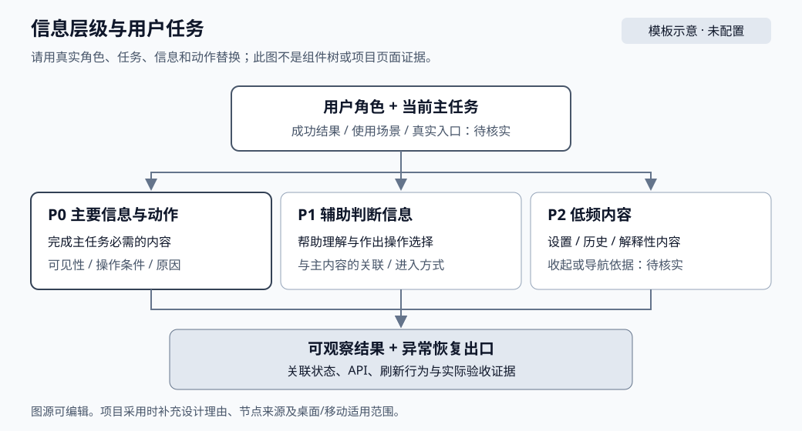

# 09 信息架构与设计决策

> 本文沿用模板结构。已核实的项目事实标注来源；未核实项保留 `TODO(待核实)`，不作为行为结论。当前只有因子挖掘模块有已登记事实，其余产品页面尚未核查。

## 页面与用户任务

每个页面/模块有自己的编号文档，在 [00 索引](00-index.md) 登记。可使用 [页面模块模板](templates/page-module.md)。

| 页面/模块与文档 | 用户角色与使用场景 | 用户主任务 | 可观察成功结果 | 路由/入口与证据 | 设计维护人 |
|---|---|---|---|---|---|
| 因子挖掘 main：[06](06-factor-mining.md) | 研究用户，在主产品中配置、提交并观察挖掘任务 | 估价并提交任务，跟踪状态，查看候选与 AI 提案 | 提交得到 job 回执；作业终态可读；候选/详情与同一 run 对应 | `/#/factor-mining`，dashboard 权限；[01](01-routes.md)、[03](03-state-and-api.md) | TODO(待核实) |
| 因子挖掘 standalone：[06](06-factor-mining.md) | 同上，独立兼容页 | 同上 | 同上；仅代表 standalone 目标 | `/`；[01](01-routes.md) | TODO(待核实) |

先确认用户要完成的任务，再定义页面区域。用户任务、导航结构、视觉优先级、组件嵌套关系分别记录；组件树不能代替信息架构。

## 信息层级与主操作

P0/P1/P2 表示优先级；首屏可见性需要真实截图核实，当前未采集。

| 信息/动作 | 优先级与理由 | 首屏可见性及适用视口 | 所属区域与入口 | 与其他信息/动作的关系 | 对应组件/状态/证据 |
|---|---|---|---|---|---|
| 配置、估价并提交任务 | P0；完成主任务必需 | TODO(待核实) | 提交 tab：`SubmitJob` | 提交成功后切换到作业列表 | [06](06-factor-mining.md) FM-01；五态见 [03](03-state-and-api.md) |
| 搜索模式与进化/保留段参数 | P0；决定提交内容与 API 字段 | TODO(待核实) | 提交 tab 的模式与高级设置 | 模式切换裁剪字段，见 [03](03-state-and-api.md) | [06](06-factor-mining.md) FM-02 |
| 查看作业状态与详情 | P1；支撑判断下一步 | TODO(待核实) | 作业 tab：`JobList`、`JobDetail` | 活动任务 5 秒轮询，终态停止 | [06](06-factor-mining.md) FM-03 |
| 浏览候选与详情 | P1；结果消费 | TODO(待核实) | 候选 tab：`CandidateList`、`CandidateDetail` | 任务可带 `tab/runId` 直达候选 | [06](06-factor-mining.md) FM-05、FM-08 |
| AI 提案与研究审计 | P2；解释 AI 运行与研究计数 | TODO(待核实) | 作业详情内的 AI 摘要/提案表或卡片 | 依赖 AI 终态结果 | [06](06-factor-mining.md) FM-07、FM-09 |

## 信息结构图与操作路径

上图为模板示意，待替换为本项目实际信息结构图。

- 信息树：研究用户 → 因子挖掘页 → 提交 / 作业 / 候选三个 tab → 各区域内容与操作。主产品与 standalone 分别维护。
- 主流程：入口 `/#/factor-mining`（或 standalone `/`）→ 填写配置 → 估价 → 提交 → 作业回执 → 作业列表轮询 → 终态详情 → 候选筛选/详情。
- 异常分支：参数 400、未登录 401、无权限 403、越权/不存在 404、网络与 500；具体错误键与 UI 反馈见 [03](03-state-and-api.md)、[06](06-factor-mining.md)。
- 跨页面导航：任务直达候选时 `tab/runId` 保存在路由 query，刷新恢复同一 run 筛选；重放表单临时状态刷新后重置。

## 设计决策与修改边界

| 决策/约束 | 用户原因与取舍 | 必须保留的内容/行为 | 可调整部分与适用范围 | 当前依据/目标设计 | 审阅人及状态 |
|---|---|---|---|---|---|
| main 复用 Ant Design Vue 与 `--qd-*` tokens；standalone 保持 Element Plus | 避免两套产品 UI 体系和认证/主题混用 | 主产品 `a-*` 控件、`qd-workspace-page`/`qd-page-frame`、既有 token | 具体页面布局与组件组合；需设计评审 | [02](02-components.md) | 待核实 |
| 三种搜索模式按模式裁剪请求字段 | 非 AI 模式携带 AI 字段会被 API 拒绝 | `searchMode` 与 AI/进化字段的裁剪规则 | 控件呈现与默认值 | [03](03-state-and-api.md) | 待核实 |
| 提交回执不等于计算成功 | 避免把 queued 当成功结果 | 作业轮询到终态、失败/取消可区分 | 轮询提示与刷新策略 | [03](03-state-and-api.md)、[06](06-factor-mining.md) | 待核实 |
| 候选是表达式当前行，历史失败证据读 run 结果 | 重复运行可能更新候选归属 | runId 筛选、刷新恢复、旧结果不臆造 | 候选列表呈现 | [03](03-state-and-api.md) | 待核实 |
| 保留段只预留、本轮未评估 | 防止把未验证数据当最终测试结果 | `holdout.evaluated=false` 与边界展示 | 后续最终评估设计 | [03](03-state-and-api.md) | 待核实 |
| standalone 保留至主产品覆盖并通过验收 | 兼容页仍有既有用户与契约 | 现有兼容、契约和验证维护 | 删除需明确清理任务与部署证据 | [00](00-index.md)、[06](06-factor-mining.md) | 待核实 |

用可观察的约束替代“高级、简洁、现代”等单独形容词。参考图应标明采用哪些布局特点、哪些不适用；外部参考不能作为本项目当前实现证据。

已有缺陷在 [10 布局与视觉基准](10-layout-and-visual-baseline.md) 的已知问题表登记，不自动成为必须保留的设计约束。

## 代表性内容与数据边界

数据来自可复现 fixture 或已核实业务场景；当前数据集准备方式与截图均为 `TODO(待核实)`。字段含义与空值语义以 [03](03-state-and-api.md) 的契约为准。

| 内容类别 | 代表性输入/准备方式 | 页面展示规则与预期结果 | 对应状态/组件 | 用例与图示/截图 |
|---|---|---|---|---|
| 常规任务配置与状态 | TODO(待核实) | 三种搜索模式、进化参数与 holdout 初值/范围 | `SubmitJob`、`JobList`、`JobDetail` | [04](04-test-map.md) FM-01/02；截图未采集 |
| 长名称、长数字与多语言 | `researchNotes` ≤8000；长表达式 | 换行/截断/完整值查看方式，TODO(待核实) | 提交表单、候选/详情 | 截图未采集 |
| 零值、空字符串、null/缺失、未知 | TODO(待核实) | 成功空 items 显示空态；失败不得显示成空结果；未知不得显示为零 | 列表/详情 | [03](03-state-and-api.md)、[06](06-factor-mining.md) |
| 大/小/负数、精度、单位与时区 | `holdoutRatio` 0–0.30；`aiRounds` 1–3；`aiProposalsPerRound` 1–20；日期区间 | 格式与舍入来源，TODO(待核实) | 提交表单 | [03](03-state-and-api.md) |
| 空列表、单条、多条与高密度内容 | 作业/候选 `limit`；提案 `limit=200` | 行高、滚动、分页及溢出，TODO(待核实) | 列表/表格 | [04](04-test-map.md) |
| 异步更新、过期与部分数据 | 活动任务 5 秒轮询；AI 运行中提案已写入 | 更新提示、位置/选择保持和恢复，TODO(待核实) | 作业/提案 | [06](06-factor-mining.md) |

不适用的类别逐项写理由和源码/产品依据。截图使用可公开的代表性数据；测试数据与真实业务结果分别标识。

## 经审阅的页面样板

| 样板模块/真实入口 | 覆盖的任务与数据集 | 组件与 token 来源 | 当前截图/可运行入口 | 已审阅基准 ID 与范围 | 维护人/审阅状态 |
|---|---|---|---|---|---|
| 未配置 | 未配置 | [02](02-components.md) | main `/#/factor-mining`；standalone `/` | 未配置 | 未配置 |

优先选一个代表性模块完成设计、实现与验收，再登记为可复用样板。样板只约束已审阅的范围；其他页面仍按自己的用户任务和数据密度验证。可运行组件样例及交互变体登记在 [02](02-components.md)，不要求采用特定展示工具或新增依赖。

## 维护与验收

- 新增或调整任务、主操作、区域优先级、内容边界时，同批更新模块文档、信息结构图和 [01](01-routes.md)/[03](03-state-and-api.md)/[04](04-test-map.md) 的关联记录。
- 信息层级与布局分别记录，布局、资产类型、实际截图与视觉差异统一遵循 [10](10-layout-and-visual-baseline.md)。
- 每个受影响模块必须可找到用户任务、信息结构图、布局图、真实截图、组件/契约/测试映射；缺项保留待核实并记录阻塞。
- 模板示意、草案与外部参考不得作为真实页面的验收证据。
