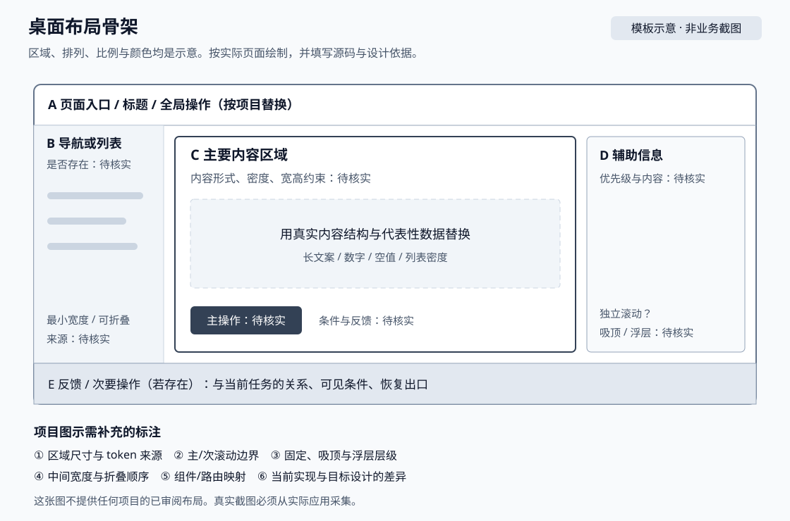
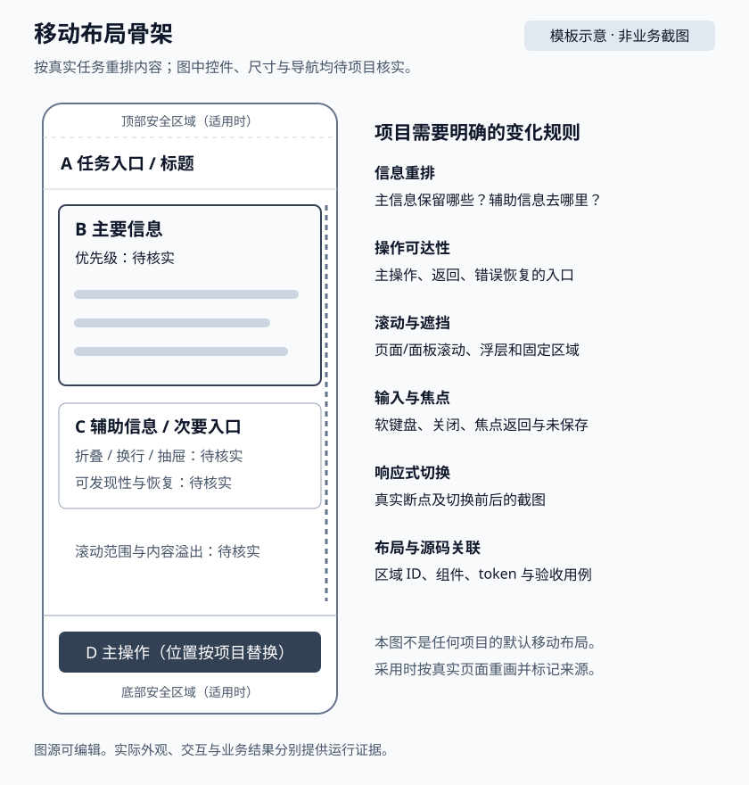

# 待编号 页面模块模板

> 模板未配置。复制到 `web_doc` 根目录，使用下一个空闲编号与真实模块名；已有编号只增不改。复制后将本文 Markdown 链接中的 `../` 改成 `./`，检查全部引用，再在 00 与项目规则入口登记。以下示意不能作为项目事实。

## 1. 模块身份与用户任务

| 项目 | 已核实事实与证据 |
|---|---|
| 模块/真实路由/入口/权限 | TODO(待核实) |
| 用户角色、主任务与成功结果 | TODO(待核实) |
| 组件、契约、状态与测试入口 | TODO(待核实) |
| 维护人、核对版本/日期与采用状态 | TODO(待核实)；未配置 |

共同定义见 [09 信息架构](../09-information-architecture.md)，视觉材料规则见 [10 视觉基准](../10-layout-and-visual-baseline.md)。每项事实链接源码或实际运行证据。

## 2. 信息层级与设计决策

| 区域/内容/动作 | 用户任务与优先级 | 首屏/收起/进入方式 | 设计原因与取舍 | 必须保留/允许调整/来源 |
|---|---|---|---|---|
| TODO(待核实) | TODO(待核实) | TODO(待核实) | TODO(待核实) | TODO(待核实) |

## 3. 布局与响应式

| 视口/实际断点与源码 | 区域宽高/间距/token | 重排/折叠顺序 | 滚动/吸顶/浮层/主操作 | 图示/当前截图/目标设计 ID |
|---|---|---|---|---|
| TODO(待核实) | TODO(待核实) | TODO(待核实) | TODO(待核实) | TODO(待核实) |

## 4. 内容、状态与交互

- 代表性数据集及准备方式，长文案、多语言、数字极值、零值与未知值、高密度/异步数据的展示规则：TODO(待核实)。
- loading/empty/error/success/unauthorized/forbidden 的触发、可见反馈与恢复；不适用逐项附依据：TODO(待核实)。
- hover/选中/disabled/submitting、重复操作、焦点进入与返回、Esc/关闭、未保存、滚动与刷新行为：TODO(待核实)。
- 组件变体、真实 token、可运行样例及使用规则：关联 02，TODO(待核实)。
- 用户入口 → 操作 → API（或不适用依据）→ 具体业务结果 → 刷新后的预期：关联 03/04，TODO(待核实)。

## 5. 当前实现、目标设计与已知问题

在这里内嵌实际图片，提供说明性 alt 和文字摘要，并链接图源/资产索引。没有真实截图时保留待核实，不把上方示意改名为当前实现。

| 资产 ID/类型/审阅状态 | 图片与源码/可运行入口 | 版本/路由/状态/视口/主题/语言/数据集 | 维护人/审阅人/证据 |
|---|---|---|---|
| TODO(待核实) | TODO(待核实) | TODO(待核实) | TODO(待核实) |

| 已知问题/当前现象 | 对用户任务的影响 | 目标及修改边界 | 处理状态/验证证据 |
|---|---|---|---|
| TODO(待核实) | TODO(待核实) | TODO(待核实) | 待核实 |

## 6. 验收与基准维护

| 场景/业务与视觉预期 | 用例/命令或人工步骤 | 业务/API/刷新结果 | 截图/差异与处理 | console/network/a11y | 审阅范围与未覆盖项 |
|---|---|---|---|---|---|
| TODO(待核实) | TODO(待核实) | 未执行 | 未执行 | 未执行 | TODO(待核实) |

修改前实际打开图示与基准，记录观察；实现后采集同条件截图，处理差异并复核，再更新已审阅基准、元信息和 04/05 映射。读图/启动受阻时记录限制与手动步骤，保持未验证状态。
