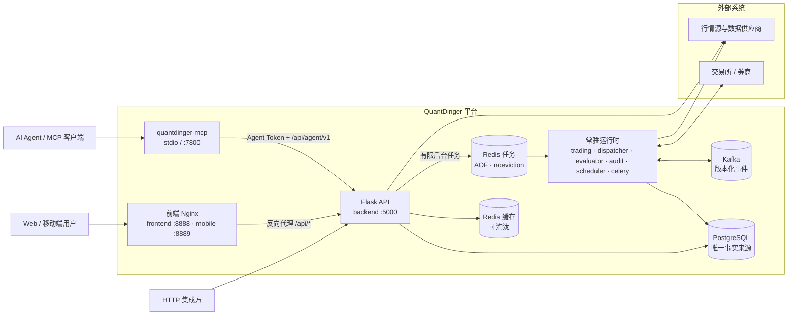
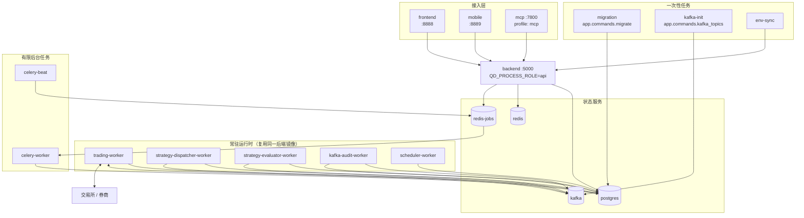
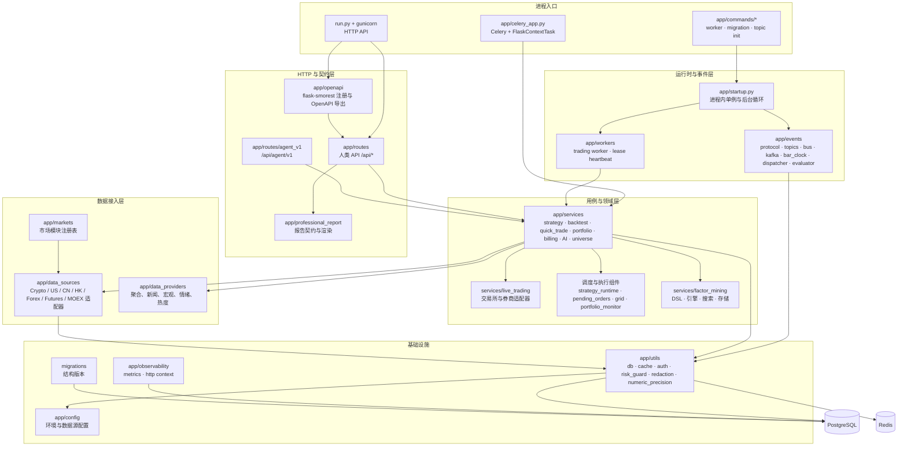
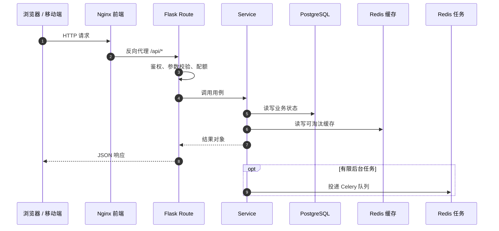
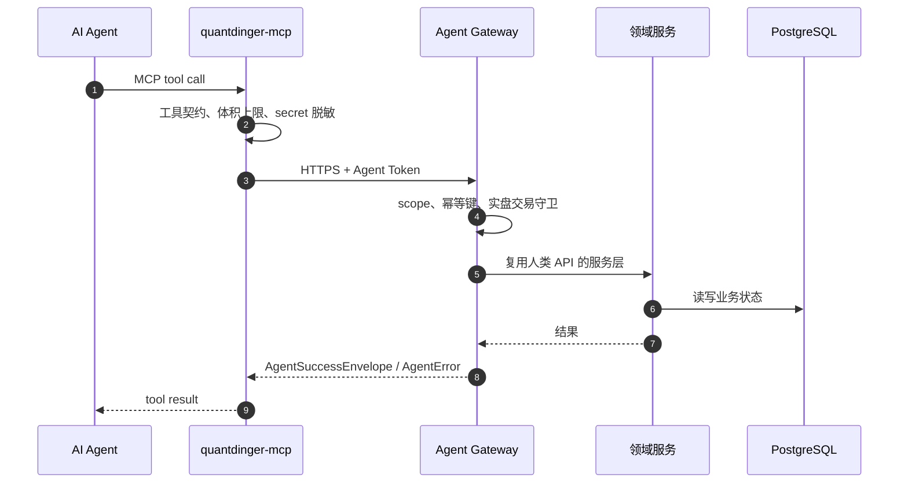
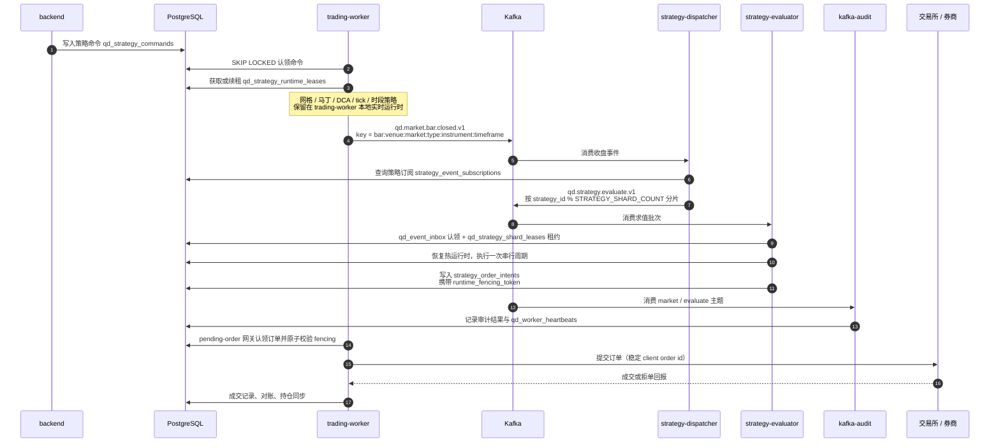
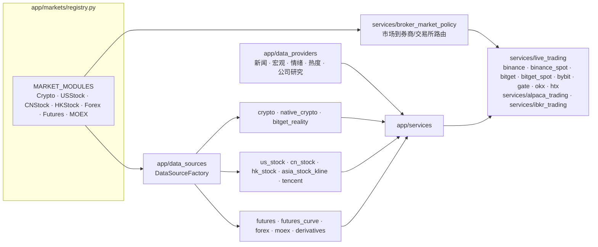

# QuantDinger 系统架构图

> 本文依据当前 `main` 工作树源码梳理生成：`backend_api_python/app`、`mcp_server/src/quantdinger_mcp`、根目录 Compose 拓扑、`backend_api_python/migrations` 以及 `docs/architecture` 的既有口径。
> 生成日期：2026-10-18；代码基线：`853de7b`；`VERSION`：5.5.1。
> 本文只描述当前态。V5.4–V5.7 的历史阶段记录见同目录 `V5_*` 文档。

## 1. 系统上下文

三条访问路径共用同一套服务层，但入口与鉴权不同：

| 路径 | 入口 | 鉴权与约束 |
| --- | --- | --- |
| 人类用户 | `frontend` / `mobile` 的 Nginx 反代 `/api/*` | 用户会话 / JWT；服务端权威鉴权 |
| AI Agent | `quantdinger-mcp` → `/api/agent/v1` | Agent Token、scope、`Idempotency-Key`、实盘确认标志 |
| HTTP 集成方 | 直接调用 `/api/*` | 按 `docs/api/openapi.yaml` 契约 |

## 2. 部署拓扑（Docker Compose）

| 服务 | 启动方式 | 职责 | 明确不负责 |
| --- | --- | --- | --- |
| `backend` | `gunicorn -c gunicorn_config.py run:app` | 鉴权、校验、查询、持久命令提交 | 交易循环、长期调度 |
| `trading-worker` | `python -m app.commands.trading_worker` | 控制/实时策略、券商会话、带 fencing 的下单、对账、持久化网格 Actor | 对外 HTTP、分布式 K 线求值 |
| `strategy-dispatcher-worker` | `python -m app.commands.strategy_dispatcher_worker` | 消费 K 线收盘事件，发布稳定策略分片批次 | 执行策略代码、下单 |
| `strategy-evaluator-worker` | `python -m app.commands.strategy_evaluator_worker` | 常驻 K 线运行时、收件箱认领、租约、检查点、订单意图 | 直接向交易所下单 |
| `kafka-audit-worker` | `python -m app.commands.kafka_audit_worker` | 独立审计事件协议与投递 | 策略决策、下单 |
| `scheduler-worker` | `python -m app.commands.scheduler` | 组合监控、部署调度、支付扫描、信号提醒 | 通用 Celery 任务 |
| `celery-worker` | `celery -A app.celery_app:celery_app worker` | AI、回测、报告、维护等有限任务 | 长期策略运行时 |
| `celery-beat` | `celery -A app.celery_app:celery_app beat` | 周期性任务派发 | 业务执行 |
| `migration` | `python -m app.commands.migrate` | 启动前失败即停的结构迁移 | 并发提供 API |
| `kafka-init` | `python -m app.commands.kafka_topics` | 幂等创建版本化主题 | 处理运行时事件 |

`frontend` / `mobile` 使用预构建镜像，主前端源码不在本仓库跟踪范围内；`mcp` 是独立镜像且只在 `mcp` profile 下启动。

## 3. 后端代码分层

| 目录 | 当前职责 | 不应放入 |
| --- | --- | --- |
| `app/routes` | HTTP 解析、鉴权检查、响应映射 | 交易循环、交易所规则、长任务 |
| `app/openapi` | 路由注册、OpenAPI 导出、标签元数据 | 业务行为 |
| `app/services` | 用例编排、事务边界、幂等、重试 | Flask `request` / `g`（路由边界除外） |
| `app/services/live_trading` | 交易所/券商适配器、订单 API 归一化 | 策略生命周期、用户鉴权 |
| `app/data_sources` | 原始行情适配器与抓取策略 | 下单、策略状态变更 |
| `app/data_providers` | 聚合行情、新闻、宏观、情绪数据 | 交易决策 |
| `app/events` | 事件协议、主题、进程内总线、Kafka 生产/消费 | 业务状态持久化 |
| `app/workers` / `app/commands` | 常驻 worker 循环与进程入口 | HTTP 响应格式 |
| `app/utils` / `app/config` | 低层基础设施与环境配置 | 功能工作流、运行时副作用 |

## 4. 请求路径

### 4.1 人类 Web API

### 4.2 Agent Gateway 与 MCP

要点：

- MCP 是 `/api/agent/v1` 的薄包装，REST 仍是事实来源。
- 所有有副作用的 W/B/N/T 工具都要求调用方生成 `idempotency_key`；重试必须复用。
- `place_quick_order` 需要 `confirm_order=true`，实盘还需 `confirm_live_trading=true`；服务端额度、allowlist 与交易开关仍然生效。

## 5. 事件驱动交易闭环

### 5.1 事件主题现状

代码证据：`app/events/topics.py`、`app/events/dispatcher.py`、`app/events/evaluator.py`、`app/commands/kafka_audit_worker.py`。

| 主题 | 分区 | 保留 | 当前状态 |
| --- | ---: | ---: | --- |
| `qd.market.bar.closed.v1` | 6 | 3 天 | 活跃：trading-worker 生产，dispatcher 与 audit 消费 |
| `qd.strategy.evaluate.v1` | 12 | 3 天 | 活跃：dispatcher 生产，evaluator 与 audit 消费 |
| `qd.strategy.lifecycle.v1` | 12 | 7 天 | 已定义；当前执行路径未使用 |
| `qd.order.intent.v1` | 12 | 30 天 | 已定义；订单意图当前以 PostgreSQL `strategy_order_intents` 为准 |
| `qd.order.event.v1` | 12 | 30 天 | 已定义；当前成交回报走数据库与实时流 |
| `qd.runtime.dlq.v1` | 3 | 30 天 | 已定义；保留给有界重试后的隔离消息 |

> Kafka 提供有序传输，但 offset 不能替代 `qd_event_inbox`、租约、fencing token、幂等键或订单对账。

### 5.2 策略类型与所有者

| 策略类型 | 当前所有者 | 触发与恢复路径 |
| --- | --- | --- |
| 普通 K 线收盘 Strategy API V2 | `strategy-evaluator-worker` | Kafka 分片批次、持久收件箱、运行时租约、热状态检查点 |
| 使用交易所挂单的网格 | `trading-worker` | 私有成交流或 REST 对账、持久化网格 Actor 邮箱 |
| 马丁、DCA、tick 驱动、交易时段驱动 | `trading-worker` | 策略租约、本地实时调度器、fencing |
| 实盘待执行订单 | `trading-worker` | PostgreSQL 认领、fencing 校验、稳定客户端订单 ID |
| AI、回测、报告、维护任务 | `celery-worker` | 持久 Redis 任务队列与重试策略 |

### 5.3 持久状态与协调原语

| 表 / 机制 | 作用 |
| --- | --- |
| `qd_strategy_commands` | 策略启动、停止、重启、对账命令 |
| `qd_strategy_runtime_leases` | 策略运行时所有权与可续租租约 |
| `qd_strategy_shard_leases` | evaluator 分片所有权与单调递增 fencing token |
| `qd_event_inbox` | Kafka 消费去重与完成状态 |
| `strategy_order_intents` | 运行时产生的订单意图，携带 `runtime_fencing_token` |
| `pending_orders` | 待执行订单与提交/对账状态 |
| `qd_process_leases` | 全局轮询器与调度循环的 leader 所有权 |
| `qd_worker_heartbeats` | worker 健康与最后处理位置 |
| `qd_grid_actor_events` / `qd_grid_actor_state` | 网格 Actor 邮箱与检查点 |

## 6. 行情与交易适配层

行情身份必须包含交易所/数据提供方、市场、市场类型、instrument ID 和周期；`BTC/USDT` 这类符号字符串不是全局唯一行情源，不能作为唯一路由键。

## 7. 关键边界与不变量

- HTTP 进程不启动交易循环、调度线程或交易所会话。
- evaluator 只产生带 fencing 的订单意图，不直接向交易所下单。
- 交易所提交必须经过 pending-order 网关；订单意图与待执行订单同时携带 `runtime_fencing_token`，网关在认领时再次原子校验。
- PostgreSQL 是命令、租约、心跳、审计、收件箱、Actor 邮箱、策略和交易状态的唯一记录来源。
- `redis` 可淘汰，只做缓存；`redis-jobs` 开启 AOF 与 `noeviction`，只承载 Celery。
- 新增常驻工作必须声明唯一所有者、幂等策略与健康心跳。
- `/api/agent/v1` 是对外 Agent 契约边界；改契约要同步 `docs/agent/agent-openapi.json` 与对齐测试。
- MCP 能力继承后端相同的鉴权、scope、幂等、限流与实盘交易守卫。

## 8. 维护方式

- 新增或调整进程角色、Kafka 主题、顶层包时，同步更新本文图 2、图 3 与第 5 节。
- 代码变更后可运行 `graphify update .` 刷新本地代码图谱；`graphify-out/` 不提交。
- 文档链接校验：`python scripts/check_docs.py`。
